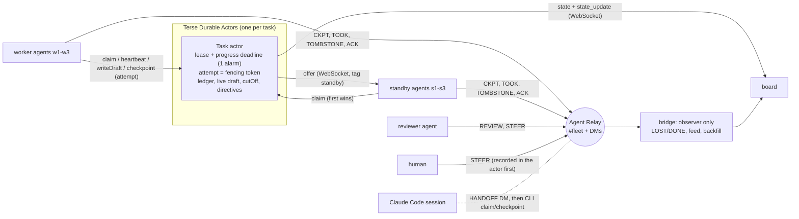

# Afterlife

**When an agent dies, its work doesn't.** Durable task leases and context handoff for long-running AI agents, built at Haunted Hacks: Real-Time AI Edition (31 Oct 2026) with Terse Durable Actors and Agent Relay.

Kill an agent halfway through a sentence, and kill the supervisor with it. Ten seconds later another agent finishes that sentence, mid-word, keeps the instruction a human gave the dead one, and a reviewer agent checks the handoff over Relay. When the dead agent's frozen twin wakes up, its writes bounce. Nothing restarted anything.

## Why agents need this

Long-running agents (research, coding, ops) die all the time: OOM kills, deploys, laptops closing, rate-limit loops, hung tool calls. Today the usual answer is "re-run it".

| Existing tool | What it does | What it does not do for an LLM agent |
|---|---|---|
| Job queues (SQS visibility timeout, Celery `acks_late`) | Re-deliver a job after a timeout | The new worker starts from zero; nothing carries the dead worker's partial work or the human's instructions |
| Temporal / Restate | Replay deterministic workflow code | LLM output is not deterministic, so an agent loop cannot be replayed; it has to be *continued* |
| LangGraph / agent checkpointers | Save state between steps | No lease and no fencing: nothing notices the agent is gone, and a resumed zombie can still write |
| A database row plus a cron sweeper | Can detect expiry | Needs a sweeper process, polls instead of pushing, and has no live channel to the agents |

Afterlife gives each task a Durable Actor that owns:

- **A lease and a progress deadline on one alarm.** A silent agent (no heartbeat) and a *stuck* agent (heartbeating, but no new words) are both caught inside the actor, with no supervisor running.
- **An attempt number used as a fencing token.** Every write carries it; a zombie's writes are rejected and recorded, never thrown away silently.
- **The work itself:** a ledger of completed steps, the live draft of the step being written, the half-written sentence of an agent that died (`cutOff`), and human instructions.
- **Offers pushed to standby agents over its own WebSockets.** The first claim wins. The successor inherits the ledger, the cut-off sentence and the instructions, and continues.

Agents talk to each other over **Agent Relay**: who took over (`TOOK`), a notice to the agent replaced (`TOMBSTONE`), human and peer instructions (`STEER`), acknowledgements (`ACK`, 👀, ✅), and continuity reviews (`REVIEW`) from a reviewer agent. A Claude Code session can join as a standby: it receives the `HANDOFF` as a Relay DM and takes the task over with a small CLI.

## Architecture



The bridge is not on the recovery path. Kill it and every handoff still happens; when it comes back it reads Relay's history and shows what the agents said while it was down.

## The two-minute demo

Open the board and press **▶ Story**, or drive it with the buttons. Every beat is a real signal sent to a real process.

| Beat | What you see |
|---|---|
| Three agents write | Each section types itself out on its card, streamed into the actor |
| A human steers w2 | "write it like a ghost": recorded in the actor, then sent as a Relay DM; w2 reacts 👀, ACKs, ✅ |
| `kill -9` w2 **and** the bridge | The lease expires inside the actor, which offers t2 to the standbys; one claims it within about 100 ms. w2's half-written sentence turns red and struck through, and the standby finishes it mid-word, still writing like a ghost |
| Freeze w3, hang w1 | w3 goes silent. w1 keeps heartbeating (its lease bar stays full), but the progress deadline flags it **stuck**. Both tasks get new owners |
| Agents talk | Over Relay: `TOOK`, `TOMBSTONE`, the reviewer's `REVIEW` in the checkpoint's thread, the new owner's `ACK`, and an `ACK` to the human saying their instruction was kept |
| Wake the zombie | w3's first write carries attempt 1; the actor rejects it (`stale-attempt`), records it on the card, and w3 exits |
| Restart the bridge | It backfills the feed from Relay: everything the agents said while it was dead |

Each takeover card shows what was saved: "s1 took over from w2 (silent) at step 4 · recovered in 0.1s, no supervisor · inherited 3 steps (17s of agent work) + a half-written sentence + the human's instruction".

Honest limits: delivery is at-least-once; completed steps are never redone and a cut-off sentence is continued, not rewritten. A crash of the actor runtime itself drops pending alarms in local dev, so any connection or state read re-arms them (and standbys and the bridge expire overdue leases). Without `OPENAI_API_KEY` the agents write labeled canned text (`LLM: CANNED` on the board). Data is synthetic.

## Run it

Requirements: Bun 1.4.2+, a running Agent Relay local server (`npx -y agent-relay@15.0.1 init`, serves `http://127.0.0.1:8787`), optional `OPENAI_API_KEY`.

```bash
cd actor && bun install && bunx durable-actors dev          # terminal 1: actor runtime on :7100
cd app && bun install && bunx durable-actors generate --out-dir generated
cd app && scripts/demo.sh up                                 # bridge, reviewer, standbys s1-s3, workers w1-w3, control
open http://127.0.0.1:3000                                   # press ▶ Story, or use the agent buttons
```

The same faults from a terminal: `scripts/demo.sh kill-w2` (w2 and the bridge), `stop-w3` / `cont-w3`, `hang-w1`, `bridge`, `down`, `stop-all`. `REVIEWER=0 scripts/demo.sh up` runs without the reviewer agent.

### A Claude Code session as the standby

Start the bridge with the session's Agent Relay name, and stop the scripted standbys so the session is the only one:

```bash
CLAUDE_STANDBY=<relay name of the Claude Code session> scripts/demo.sh up
kill $(cat ../.run/pids/s1) $(cat ../.run/pids/s2) $(cat ../.run/pids/s3)
kill -9 $(cat ../.run/pids/w2)      # the bridge DMs the HANDOFF prompt to the session
```

The session receives the DM as a turn and uses the CLI, which fences every write by attempt exactly like a worker:

```bash
bun run app/tools/afterlife.ts offers                      # lost tasks waiting for a claim
bun run app/tools/afterlife.ts wait                        # or block on the actors' offers (no bridge needed)
bun run app/tools/afterlife.ts claim t2 2 --as cc          # fact sheet, saved steps, cut-off sentence; 120 s lease
bun run app/tools/afterlife.ts checkpoint t2 2 --as cc --step 2 --summary "..." --text "<cut-off text + continuation>"
bun run app/tools/afterlife.ts complete t2 2 --as cc       # any fenced write prints STOP
```

`app/.env`: `DURABLE_ACTORS_CONTROL_PLANE_URL=http://127.0.0.1:7100`, `RELAY_BASE_URL=http://127.0.0.1:8787`. The Relay workspace key is read from `~/.agentworkforce/relay/workspaces.json` (or `RELAY_WORKSPACE_KEY`) and never sent to the browser. Tunables: `LEASE_MS` (10000), `PROGRESS_MS` (15000), `HEARTBEAT_MS` (2000), `STEP_PACE_MS` (6000), `LLM_MODE` (`openai`|`canned`), `OPENAI_MODEL`, `CLAUDE_STANDBY`, `REVIEWER`, `STEER_ENABLED`.

## Agent-to-agent protocol (Agent Relay)

| Message | From | To | Meaning |
|---|---|---|---|
| `CKPT` | owner | `#fleet` | Step saved in the actor (summary and reused details in metadata) |
| `LOST` | bridge | `#fleet` | The actor declared the task lost (silent or stuck); informational |
| `TOOK` | new owner | `#fleet` | Claimed attempt N, from whom, at which step, after how long, carrying what |
| `TOMBSTONE` | new owner | the replaced agent | Stop writing; your attempt is fenced |
| `STEER` | human or reviewer | current owner | Instruction; a human's is recorded in the actor before delivery |
| `ACK` | owner | thread or human | Instruction recorded; or "I took over and kept your instruction" |
| 👀 ✅ | owner | the STEER message | Read, then done |
| `REVIEW` | reviewer | the takeover `CKPT` thread | Continuity check of the first step after a takeover |
| `HANDOFF` | bridge | a Claude Code session | Self-contained prompt to take a task over with the CLI |
| `DONE` | bridge | `#fleet` | Task completed |

## Layout

- `actor/src/task.ts`: the `Task` Durable Actor (lease and progress deadline, fencing, ledger, live draft and cut-off sentence, offers to standby sockets, directives, alarm self-repair).
- `app/worker/`: worker and standby agent process, streaming LLM step writer, synthetic fact sheets.
- `app/reviewer/`: reviewer agent; talks only over Relay.
- `app/bridge/`: observer: LOST and DONE on Relay, board server, WebSocket grants, feed with Relay backfill, steering, HANDOFF DM to a Claude Code standby.
- `app/tools/afterlife.ts`: CLI for agents that cannot run the worker loop, such as a Claude Code session.
- `app/board/index.html`: live board (actor WebSockets plus the Relay feed), fault buttons and story mode.
- `app/scripts/`: `demo.sh` process control, `control.ts` localhost fault injection for the board, `reset.ts`.
- `app/shared/`: config, ids, Relay helpers.

## Attribution

All code in this repository was written at the event. Dependencies: [durable-actors](https://github.com/TerseAI/durable-actors) 0.14.6 (MIT), [@agent-relay/sdk](https://github.com/AgentWorkforce/relay) 15.0.1 (Apache-2.0 repository), [openai](https://github.com/openai/openai-node) 7.47.0 (Apache-2.0), [zod](https://github.com/colinhacks/zod) 4.6.7 (MIT). The Agent Relay local server (relaycast-engine 11.1.0) is run via the official `agent-relay` CLI. The fact sheets are synthetic and describe no real places.
